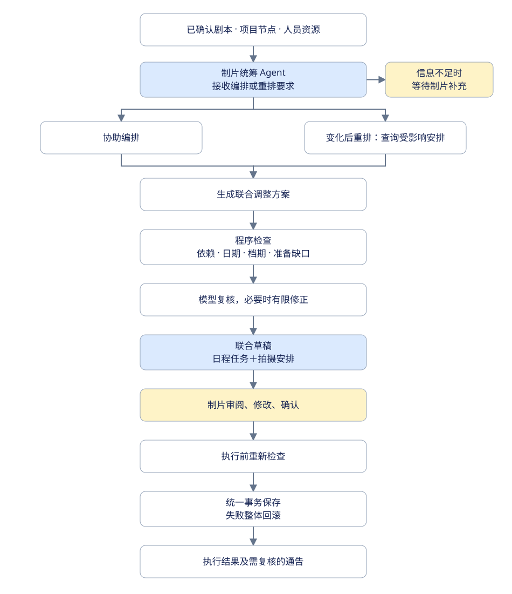
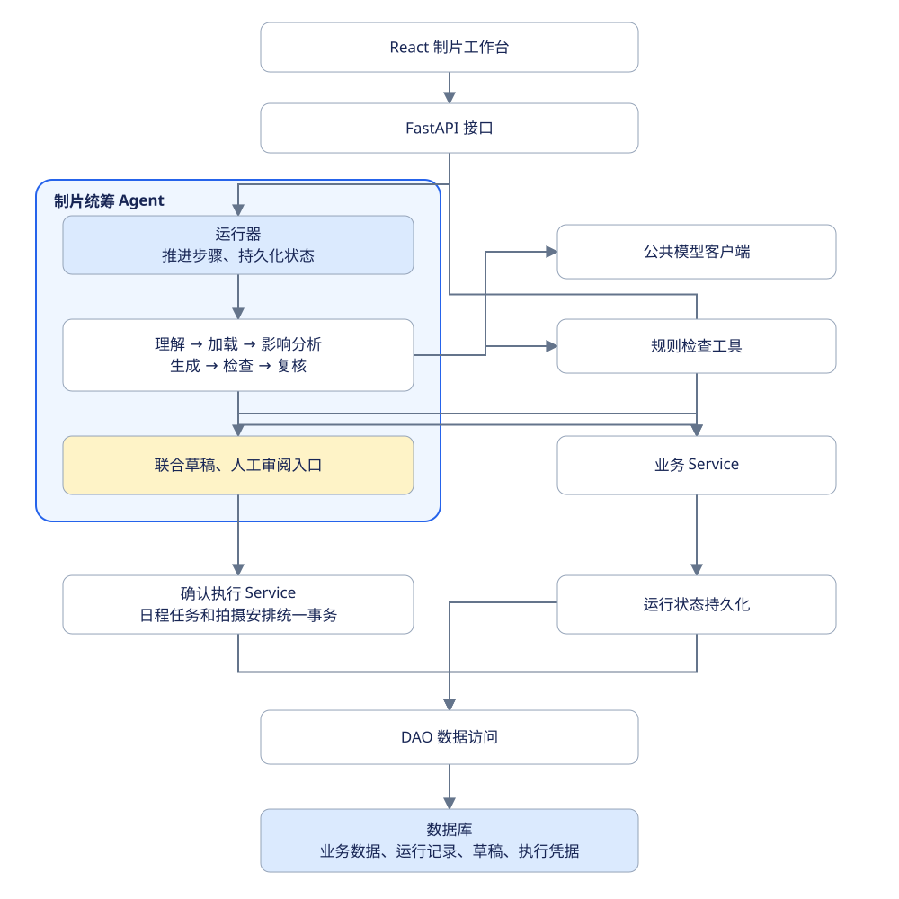

<h1 align="center">片场 · 学生制片工作台</h1>

<p align="center"><strong>Film-production-assistant</strong><br />
面向学生制片的本地工作台，从剧本拆解、项目筹备到拍摄安排和每日通告。</p>

<p align="center">FastAPI · React · SQLAlchemy · AI 辅助拆解</p>

<p align="center">
  <a href="#项目概览">项目概览</a> ·
  <a href="#业务流程">业务流程</a> ·
  <a href="#核心功能">核心功能</a> ·
  <a href="#快速开始">快速开始</a> ·
  <a href="#项目结构">项目结构</a> ·
  <a href="#当前限制">当前限制</a> ·
  <a href="#文档导航">文档导航</a>
</p>

## 项目概览

片场是为学生剧组中的制片人员开发的单人工作台，将剧本、筹备任务、人员资源、拍摄安排和通告集中管理，减少资料分散和反复核对的工作。

AI 用于生成剧本拆解和日程建议。制片统筹 Agent 根据剧本、项目节点、人员档期和资源准备情况，协助编排项目任务及拍摄计划；条件变化后分析影响、提出调整方案，经制片人员确认后统一执行。通告发布时保存版本快照，便于回看当天发出的内容。

| 工作区 | 主要用途 |
| --- | --- |
| **剧本拆解** | 导入文本、逐场提取、核对原文、人工修订、版本比较和 XLSX 导出 |
| **项目日程** | 维护筹备及收尾任务，查看部门甘特表、前置关系和到期提醒 |
| **人员资源** | 维护人员、场地、器材和道具资料，登记可用时段 |
| **拍摄安排** | 按天安排拍摄、转场、用餐、妆造、布光和置景 |
| **每日通告** | 汇总当天安排，保存草稿、发布版本和下载 TXT |
| **拍摄记录** | 逐场记录拍摄情况，从日志建立补拍安排 |

项目持续开发中，真实剧组使用质量尚待验收。功能验证范围见 [验证记录](docs/verification.md)。

## 业务流程

制片统筹 Agent 支持协助编排和条件变化后重排，两类修改合并为一份联合草稿。信息不足时等待人工补充；程序检查和模型复核后，由制片人员审阅确认。


<p align="center"><sub>以上两张 AI 生成图片为项目概念插图，非产品界面截图；具体能力以功能说明和流程图为准。</sub></p>



[查看 Mermaid 源码](assets/readme/agent-workflow.mmd)

剧本、项目节点、人员档案及档期、资源落实资料、拍摄日志和已发布通告作为只读依据；Agent 的修改范围为项目日程任务和拍摄安排。

## 核心功能

### 逐场拆解，人工确认

- 支持粘贴剧本或读取 UTF-8 TXT，最多 50,000 字、200 场。
- 后台逐场处理，通过 SSE 推送进度；单场失败不影响其他场次，可单独重试或人工填写。
- 已完成结果可立即查看和编辑，人工修改的字段受保护，不被后续模型结果覆盖。
- 未确认内容保存在服务端文件草稿中，人工确认后写入正式场次；新版剧本保留旧版记录。
- 支持导出基础 XLSX 拆解表和变更说明；桌面 Excel / WPS 兼容性尚未实测。

### 从筹备任务到拍摄安排

- 根据开拍日期、项目现状和已确认剧本摘要生成日程建议，审阅草稿后再应用。
- 使用部门甘特表查看任务，维护主责部门、协作人员、完成标准和前置任务。
- 查看人员、资源的已登记档期；未知可用时间明确显示，不自动推断。
- 拍摄安排关联正式场次，支持不同组并行、跨午夜和同场多次安排。
- 按已选人员资源检查时间冲突、档期及明确关联的筹备缺口，供人工判断。

### 每日通告和现场记录

- 从当天安排整理通告，补充集合、交妆、交通、用餐和注意事项。
- 保存通告草稿，发布后冻结快照，保留历史版本并支持 TXT 下载。
- 当天安排或关联筹备事项变化后，提示检查已有通告。
- 记录每次拍摄结果，支持临时加拍和从日志创建补拍安排；归还、交场及结款继续在项目日程维护。

### 模型接入

公共模型客户端支持 DeepSeek 和通过 Ollama 提供 OpenAI 兼容接口的本地 Qwen3。未配置模型时仍可手工编辑，AI 自动拆解和日程生成需要可用的模型服务。

制片统筹 Agent 使用持久化状态机保存运行进度，支持补充信息后继续处理；联合草稿经人工确认后，在同一事务中更新日程任务和拍摄安排，并使用执行凭据避免重复执行。旧对话 Agent 保留兼容，独立于这套联合执行流程。

## 快速开始

以下命令使用 **Windows PowerShell**。本地需安装 Python、Node.js 和 npm；后端、前端分别在两个终端运行。

### 1. 获取项目并安装依赖

```powershell
git clone https://github.com/Buer2001/Film-production-assistant.git
cd Film-production-assistant

python -m venv .venv
.\.venv\Scripts\python -m pip install -r requirements.txt

Push-Location frontend
npm ci
Pop-Location
```

### 2. 配置本地环境

首次配置时复制示例文件；已有 `.env` 时保留原配置：

```powershell
Copy-Item .env.example .env
```

若先用 SQLite 体验，将 `.env` 中的数据库地址改为：

```dotenv
DATABASE_URL=sqlite:///./film_production.db
```

示例配置默认使用本机 MySQL，需要提前创建数据库并填写账号和 `MYSQL_PASSWORD`。旧 SQLite 数据不会自动迁移到 MySQL。

需要 AI 功能时，在 `.env` 中配置 `LLM_BASE_URL`、`LLM_API_KEY` 和 `LLM_MODEL`；本地 Qwen3 的切换方式见 [详细使用说明](docs/usage-guide.md#模型调用)。密钥仅保存在本地，修改配置后重启后端。

### 3. 启动工作台

在仓库根目录的第一个终端启动后端：

```powershell
.\scripts\run-backend.ps1
```

在仓库根目录的另一个终端启动前端：

```powershell
.\scripts\run-frontend.ps1
```

| 入口 | 地址 |
| --- | --- |
| 工作台 | http://127.0.0.1:5173 |
| API 文档 | http://127.0.0.1:8000/docs |

首次使用建议先创建项目、导入剧本并确认拆解结果，再维护筹备日程、人员资源和拍摄安排。

## 项目结构

后端按技术层分包，包内按业务组织。Router 处理 HTTP 边界，Service 管理业务和事务，DAO 负责数据库访问；AI 模型通信和纯工具独立维护。



[查看 Mermaid 源码](assets/readme/agent-architecture.mmd)

制片统筹 Agent 复用既有业务服务、规则检查和模型客户端；业务数据通过 Service 和 DAO 修改，模型不能直接写库或绕过人工确认。

```text
backend/
  router/     HTTP 接口
  service/    业务流程、版本规则和事务
  dao/        数据访问
  models/     SQLAlchemy 表模型
  schemas/    输入输出及结构化校验
  agent/      制片统筹 Agent 状态机、上下文和步骤编排
  ai/         公共模型客户端、提取器和提示词
  tools/      文本处理、证据校验和导出
  common/     数据库、依赖、异常和日志
frontend/
  src/        React 工作台
scripts/      本地启动和冒烟检查
tests/        自动化测试
evaluations/  离线评估
docs/         架构、使用说明和验证记录
```

详细职责见 [架构说明](docs/architecture.md)。

## 当前限制

- 面向单制片、本机或可信环境使用，尚无登录权限，不适合直接向公网开放。
- 剧本拆解任务依赖本机单进程和文件草稿，不支持多实例共享；备份时应同时保留数据库和 `.drafts/scripts`。
- 尚无 Word / PDF 上传解析、OCR、ASR、无需人工确认的自动排程、天光校验或拖拽排期。
- 冲突和通告变更检查依赖已录入的数据及明确关联，不能替代制片人员核对；通告不会自动发送给剧组。
- 旧排期、历史通告和旧对话 Agent 保留兼容，尚未全面接入新任务及正式剧本场次；制片统筹 Agent 使用独立的联合草稿流程。
- 模型输出需人工核对；离线模拟评估结果不代表真实模型准确率。

## 开发检查

在仓库根目录使用已安装依赖的项目虚拟环境执行：

```powershell
.\.venv\Scripts\python -m pytest tests -q
.\.venv\Scripts\python -m evaluations.run
.\.venv\Scripts\python scripts/smoke.py

Push-Location frontend
npm run build
Pop-Location
```

冒烟脚本使用临时服务和临时 SQLite，不影响正式数据库。具体检查范围和历史结果见 [验证记录](docs/verification.md)。

## 文档导航

| 文档 | 内容 |
| --- | --- |
| [详细使用说明](docs/usage-guide.md) | 原 README 保留的操作细节、模型配置、数据库说明和版本记录 |
| [整体架构](docs/architecture.md) | 后端分层、模块职责和工程组织 |
| [制片统筹 Agent 设计](docs/v5-agent-design.md) | 状态机、联合草稿和受控执行 |
| [验证记录](docs/verification.md) | 已执行检查、验证环境和待验收范围 |
