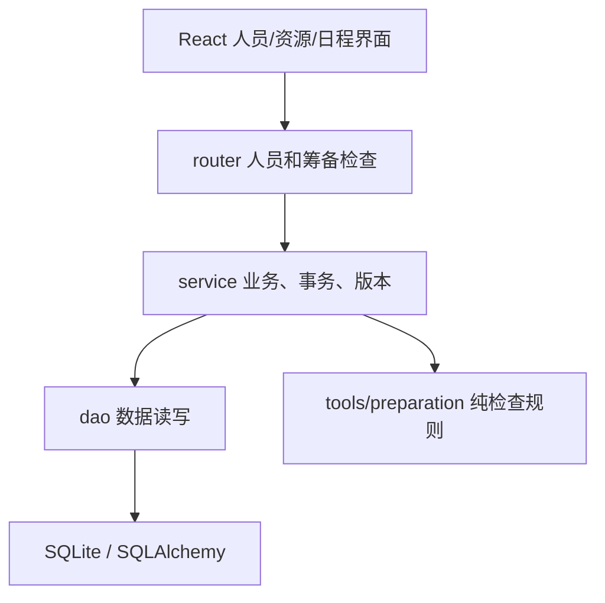

# V3 筹备落实

2026-11-03 实现。定位为单制片本地维护资料和核对落实缺口，复用 V2 日程，不增加第二套任务、不接入新的 Agent 工具。

## 业务闭环

拆解或人工需求 → 项目日程任务 → 关联具体人员和资源 → 制片记录确认情况及使用时段 → 查询筹备缺口。

- 人员有项目内稳定 ID、姓名、部门、岗位、联系方式、可用/不可用时段。旧任务手填姓名保留，不按同名自动关联。
- 资源继续存于 records，preparation 单独记录落实状态、联系人、可用时段、简要费用和结果说明。旧 status/owner/amount 保留，不自动映射为新落实事实。
- 任务沿用 project_tasks；details 增加 person_ids、requires_people、usage_period、result_notes。resource_refs 无 ID 表示未落实需求，有 ID 表示选定的具体资源。
- 资源选择不按相似名称推断“教室”就是“教学楼302”；制片选定资源后移除已落实的需求名称。
- 日期含首尾日，时刻成对可选，不填时刻表示全天。使用时段独立于任务计划日期。没有可用记录表示未知；明确不可用优先于可用记录；多个连续可用段可以共同覆盖使用时段。
- 未填写使用时段、不确定可用性、未确认资源、资源不可用分别提示；不检查未录入的隐含需求。已完成任务仍检查事实缺口，已取消任务跳过。
- 费用未知、免费、已报价、已确认分别表达。未知不填金额，免费只接受空值或零，报价/确认必须填金额；不自动生成支出、订单或付款流水。

## 分层

| 代码 | 职责 |
|---|---|
| models/person.py | project_people 人员表；不新增部门、岗位或时间段表 |
| schemas/availability.py | 人员、资源和任务共用时间契约 |
| schemas/person.py、resource.py、record.py、planning.py | 人员及资源输入、通用变更种类校验、任务扩展 |
| dao/person.py | 人员读写、正式及待审资料引用检查，不提交事务 |
| service/person.py | 项目隔离、项目 revision、保存事务和事件 |
| service/change.py | 共同资源写入边界；旧输入未提交 preparation 时保留现有值 |
| service/planning.py | 人员引用校验、人工落实字段保护、日期列及 JSON 分别序列化 |
| service/preparation.py | 汇集本项目正式资料，不把待审草稿当事实 |
| tools/preparation.py | 无数据库、无模型的缺口及可用时间规则 |
| router/person.py、preparation.py | HTTP 边界和依赖注入 |
| common/database/migrations/preparation_v3.py | 幂等新增人员表，检测结构缺失，保留旧数据 |
| features/preparation | 人员面板、共享时间编辑、姓名解析 |
| features/resources、features/planning | 扩展现有资源、任务、甘特展示和检查入口 |

技术栈沿用 FastAPI、Pydantic 2、SQLAlchemy 2、React 19、JavaScript、Vite 6 和 CSS，无新增依赖。本轮仅实测 SQLite。

## 接口

接口前缀 `/api/projects/{pid}`：

| 方法 | 路径 | 内容 |
|---|---|---|
| GET | /people | 返回 revision 和人员列表 |
| POST | /people | 请求 {revision, person}，新增人员 |
| PUT | /people/{id} | 请求 {revision, person}，更新人员 |
| DELETE | /people/{id}?revision=N | 删除未被引用的人员 |
| GET | /preparation | 返回 checked_tasks 和 issues，不修改状态或版本 |

资源和任务继续使用既有 `/resources`、`/planning/tasks` 接口。检查项包含 code、message、task_id 及可选 resource_id/person_id，前端可定位到原记录。

## 事务和兼容

- 人员、资源共用项目 revision；任务沿用日程 revision。人员和资源保存不会自动推进日程版本。
- 按项目→计划的既有锁顺序维护引用；跨项目人员、资源和联系人引用被拒绝。正式任务（含完成项）、待审日程草稿和资源草稿的引用均参与人员删除保护。
- 保存、项目版本领取和事件记录在同一事务内；异常由现有 Session 依赖回滚。前端保存失败保留输入，编辑期间禁止切页和切项目。
- 新日期列仍按 Python date 写入 SQL；JSON details 内的日期和时刻先转 ISO 字符串，防止嵌套日期无法序列化。
- 模型调整日程不能编造或覆盖人员 ID、使用时段、结果说明和人员落实要求；已有人工绑定资源保留。沿用 V2：模型可提出已有资源的关联建议，人工确认草稿后才保存，关联不等于资源已确认。
- Agent 工具保留旧 Item 写入契约，不开放 V3 人工落实字段；旧资源更新经过共用变更服务保留新增资料，不复制一套业务。

## 限制

没有数量库存、自动需求归并、完整拍摄排期占用检查、付款流水、多人登录。未用真实剧组长期使用验收，也未实测 MySQL/PostgreSQL。筹备检查只核对已录入资料，不承诺覆盖所有剧本需求。

验证结果见 [验证说明](verification.md)，实施清单见 [V3 实施](superpowers/plans/2026-11-03-preparation-v3.md)。对外 README 改版仍按结论池留到项目收尾。

## 2026-11-04 操作调整

任务日程默认清单，保留甘特图切换；清单支持部门、阶段、状态筛选，按日期排序和可选部门分组，状态可直接更新。点击任务或备注打开原生模态侧栏，再进入编辑；高级依赖和日期约束按需展开。人员资源选择复用可搜索勾选组件，既有失效引用保留待核对。保存失败在侧栏提示并保留输入。

AI 建议统一收纳生成和部门补全；项目条件放在项目设置。筹备检查和日程提醒折叠展示，草稿仍须人工确认。

人员资源档期支持周、双周、自然月，默认月；以每天为列，可横向滚动，名称固定。无选择时不显示空详情栏。面板展示备注摘要，详情展示完整备注、任务说明或落实结果和关联任务。选中对象后可新建预关联该对象及所选日期的任务，仍由人工保存。资源联系人不表示该联系人被任务占用，任务期限不作为档期使用时间。

本次无表结构和依赖变更；新增范围计算测试覆盖双周关联及闰年自然月，已有占用检查规则保持复用。
