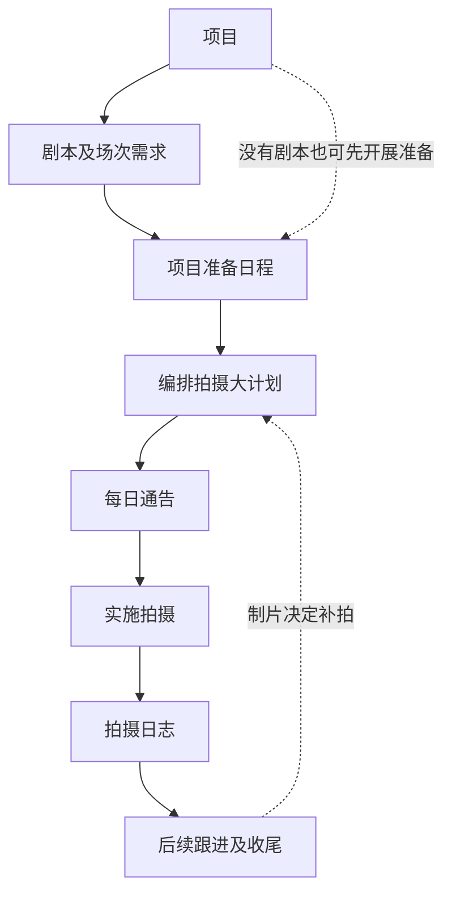
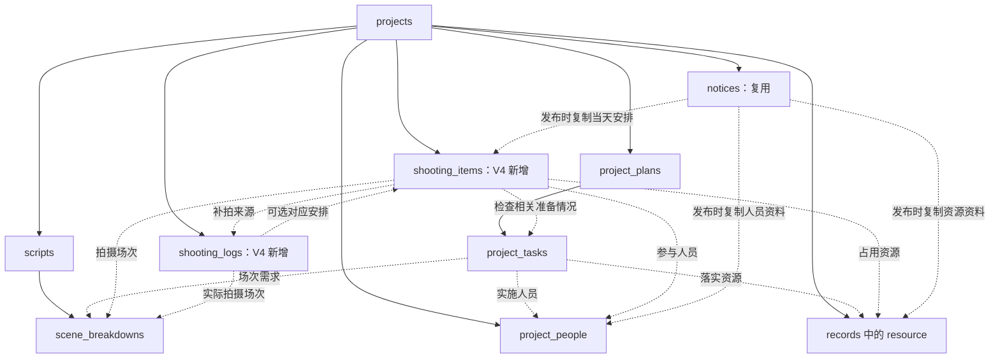
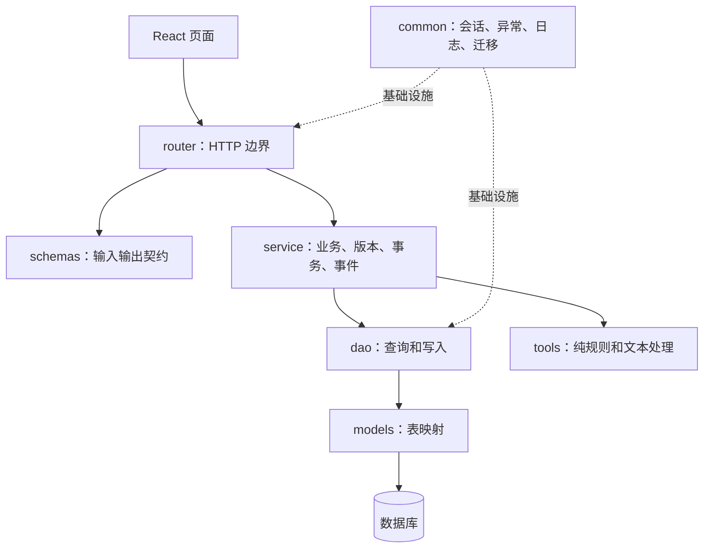

# V4 拍摄管理架构设计

日期：2026-11-04。

状态：已按确认架构实现首版，实际检查见 [验证记录](verification.md)。真实剧组使用质量尚待验收。新增表在临时 SQLite 中验证，本轮没有启动正式数据库迁移。

## 业务主线

- 项目指一次影片制作的档案，不是代码工程或拍摄计划。
- 准备日程管理任务期限及落实结果；拍摄大计划管理具体时间安排。允许准备尚未全部完成时先编排，缺口明确提示。
- 大计划按天展示安排项，包含拍摄、转场、用餐、妆造、布光置景等；允许不同人员和资源并行工作。
- 每日通告带入当天安排及相关人员资源，补充集合、交妆、交通、用餐、注意事项，人工确认后发布并冻结。
- 实施拍摄是现实活动，不因此增加独立业务模块或表。
- 日志逐场记录实际时间、完成情况、剩余内容和补拍原因，不覆盖原安排或已发布通告。
- 补拍经制片决定后重新编排，关联原日志；归还、交场、结款及遗留事项复用现有任务，由人工建立或确认，不自动新增任务。

## 数据关系

下图实线表示包含，虚线表示引用或发布时取数，不表示阶段完成门槛。

大计划是项目内安排项按日期组织的整体视图，首版不新增计划主表。补拍来源是新安排指向既有日志的业务追溯关系，不形成模块互相调用或自动递归执行。

| 数据 | 存储方向 | 关键边界 |
|---|---|---|
| 拍摄安排项 | 新增 shooting_items | 项目、类型、标题、计划起止时间、场次引用、人员引用、资源引用、补拍来源、说明 |
| 逐场日志 | 新增 shooting_logs | 项目、场次、对应安排、实际时间、完成情况、剩余内容、补拍原因 |
| 每日通告 | 复用 notices | version=0 保存当天补充信息草稿，version>0 保存发布快照，沿用按日递增版本 |
| 准备及收尾任务 | 复用 project_tasks | 不另建收尾任务体系，不把安排项复制为任务 |
| 人员和资源 | 复用 project_people、records | 用稳定 ID 引用，禁止仅靠名称匹配身份 |

实际列及契约见 models/shooting.py、schemas/shooting.py。安排保存项目、场次、完整起止时间和经校验的 JSON；日志保存项目、场次、可空安排引用、日期和经校验的 JSON。不新增第三张业务表。

### 引用规则

- 拍摄项关联一场，同一场可拆为多次安排；非拍摄项不强制关联场次。
- 场次必须来自本项目已确认的正式拆解，保留剧本版本身份，不仅保存可变化的场号。
- 人员、资源、安排、日志的所有引用都校验项目归属。
- 已有日志的安排保留追溯依据，不硬删除；使用 planned/cancelled 状态，不能更换场次、拍摄类型或补拍来源。被补拍引用的日志不能更换场次或对应安排，避免形成因果环。
- 人员和资源删除保护扩展到 V4；现有 DAO 在没有 V2 计划时提前返回的逻辑不能漏掉 V4 引用。
- 历史通告依靠快照保留名称和执行信息，不依赖当前对象仍然存在。
- 正式业务引用保护和发布快照保护分别处理，不能用保留快照代替正式引用检查。

## 代码分层

模块化单体，沿用 FastAPI、SQLAlchemy、Pydantic、React、Vite；不引入新依赖、工作流引擎、通用队列、RAG 或新 Agent。

- Router 只接收参数、调用服务、返回响应，不写 SQL 或提交事务。
- Service 汇集正式业务数据，执行归属校验、版本检查、引用保护及发布规则；统一提交业务修改和事件，不导入 FastAPI。
- DAO 可查询、更新、flush，不 commit，不调用模型，不决定业务状态。
- Models 表达存储；Schemas 表达接口契约，不能混用。
- Tools 只接收明确的数据并返回检查结果或导出内容，不查询数据库，不修改业务事实。
- Common 只放公共基础设施，不放拍摄规则。
- Main 只注册 Router 和迁移，不编排拍摄业务。

### 文件职责

以下为首版实际落位。

| 路径 | 职责 |
|---|---|
| backend/router/shooting.py | 安排、日志、检查的 HTTP 入口 |
| backend/schemas/shooting.py | 输入输出契约、类型、字段和时间边界校验 |
| backend/service/shooting.py | 安排及日志保存、正式数据汇集、补拍来源校验、事务和事件 |
| backend/dao/shooting.py | 两张新表的项目内查询和写入 |
| backend/models/shooting.py | ShootingItem、ShootingLog |
| backend/tools/shooting.py | 时间重叠、人员资源占用、拍摄检查结果组织 |
| backend/router/notice.py | 保留历史发布入口及共用导出入口；V4 发布在 shooting Router |
| backend/schemas/notice.py | 保留旧通告请求结构，V4 契约集中在 schemas/shooting.py |
| backend/service/notice.py | 从 V4 正式数据发布快照、按快照格式导出，兼容历史通告 |
| backend/tools/notice.py、tools/shooting.py | 分别承载旧通告比较和 V4 来源指纹、时间检查及快照文本导出 |
| backend/service/project.py | 项目概览和通告状态聚合，避免漏算或重复统计 |
| backend/dao/person.py、resource.py | 扩展删除引用保护，保留现有 V2/V3 保护 |
| backend/common/database/migrations/shooting_v4.py | 增量建表、必要结构检查，不清库 |
| backend/main.py | 注册 V4 Router 和增量建表入口 |
| frontend/src/features/shooting/ | 大计划、安排编辑、逐场日志；组件按实际复杂度拆分 |
| frontend/src/features/production/ | 接入新拍摄入口及通告界面，保留历史数据查看 |
| frontend/src/main.jsx | 导航和页面组装，不放拍摄业务规则 |

服务之间不按业务步骤逐个调用，不建立“准备服务→计划服务→通告服务→日志服务”的长链。各操作服务通过 DAO 获取所需数据，公共规则集中复用。后续 Agent 如接入，只调用受控服务，不直接执行 SQL。

## 操作边界

| 操作 | 服务端行为 |
|---|---|
| 读取大计划 | 项目内查询安排，按本地日期及开始时间组织，不修改数据 |
| 保存安排 | 检查项目版本、时间、场次及人员资源引用，写安排和事件 |
| 检查安排 | 汇集安排、人员资源可用时段、关联正式任务，执行纯规则，不自动改计划 |
| 发布通告 | 在一致的项目事实基础上复制当天安排及相关资料，分配当天版本并保存快照 |
| 保存日志 | 校验项目、场次及安排关联，保存实际结果和事件，不自动标记整场已拍完 |
| 建立补拍安排 | 人工保存新安排并关联来源日志，不覆盖原日志或历史安排 |
| 跟进收尾 | 人工在现有项目日程维护任务，使用现有任务的版本规则 |

接口前缀为 /api/projects/{pid}/shooting：GET 读取工作区；POST /items、PUT /items/{iid} 保存安排；POST /logs、PUT /logs/{lid} 保存日志；GET /days/{day} 读取当日来源和草稿；PUT /days/{day}/draft 保存草稿；POST /days/{day}/publish 发布。导出复用 /api/projects/{pid}/notices/{nid}/export。写入携带项目 revision；发布额外携带预览来源 fingerprint。

## 版本和事务

- 安排、日志和通告草稿保存复用 projects.revision，沿用项目条件更新和事件记录；不增加一套独立锁机制。
- V2 任务继续使用已有 project_plans.revision，不能拿项目 revision 代替任务版本。
- 发布按项目→准备计划及任务→人员资源→剧本场次→安排及日志执行当前读，复用 V2 写操作先锁项目的顺序；发布时重新计算来源指纹，拒绝与预览不一致的来源。
- 修改记录、引用校验、领取版本和追加事件必须位于同一事务；任一步失败不得残留部分写入。
- 通告保留自身按日版本及场次的剧本版本身份；快照使用 shooting_v4 格式标识和来源指纹，避免旧快照被按新格式解释。整版剧本 revision 不参加复核指纹，避免其他场次编辑误报。
- 发布快照冻结人员名称、资源名称和执行资料，而不仅是保存 ID；同时保留关联准备任务所需人员资源，避免检查误报缺失。准备任务实施人员不自动列入拍摄到场名单。读取、导出历史通告不重新拼接当前资料。
- 通告复核仅比较已明确记录的来源，不因无关数据变化统一报过期。完整跨模块变更闭环留在 V5。

## 检查规则

- 按实际人员和资源引用检测重叠，不把所有并行安排都判为冲突。
- 使用完整本地日期时间表达起止，覆盖跨午夜；首版不扩展跨时区调度。
- 人员资源可用时段复用 V3 的时间规则，未知不等于可用。
- 只检查明确关联的场次需求和准备任务，不根据标题猜测已落实，不把未提交草稿作为正式事实。
- 不引入资源容量、替代器材、自动最优排程等额外能力；已知资料不足时提示核实。

## 兼容和迁移

- 旧 records 中的 schedule 保留，不自动迁移、不双写，新旧来源在界面和接口中明确区分。
- 旧通告继续按旧快照读取和导出；V4 通告不混入旧排期。
- 人员、资源、任务和正式场次继续复用现有数据，不建立 V4 副本。
- 只新增 shooting_items、shooting_logs；notices 首版扩展 JSON 快照，不预设改旧表字段。
- 新增表沿用项目增量建表及结构检查方式；可重复运行，不以 create_all 冒充旧表字段升级，不清库替代迁移。
- 本轮实现和浏览器验证使用临时数据库；正式服务下次启动会按已确认方案执行增量建表。

## 已确认的补充规则

1. 临时加拍允许直接关联正式场次保存日志，item_id 可空；unplanned 由服务端根据引用推导。
2. 每日通告补充信息保存服务端草稿，刷新可恢复。复用 notices 的 version=0 记录，以 shooting_v4_draft 标记，与发布列表和导出隔离；发布后仍保留草稿内容，再次发布创建新版本。

前端显式保存草稿；保存失败保留输入，刷新来源不覆盖人工补充信息，未保存时保护页面和项目切换。

## 后续验收范围

- 并行安排、真实人员资源冲突、跨午夜、未知档期。
- 场次版本身份、跨项目引用拒绝、人员资源删除保护。
- 并发保存冲突、事务回滚、已有日志安排的追溯保护。
- 通告冻结、历史格式兼容、当天版本分配、相关来源变化复核。
- 逐场日志、同场多次拍摄、补拍来源、收尾任务复用。
- 按实施改动执行后端测试、离线评估、前端逻辑测试、构建及关键页面检查，记录真实结果。

自动检查和浏览器验证的实际范围见验证记录；不将模拟数据结果表述为真实剧组验收。
