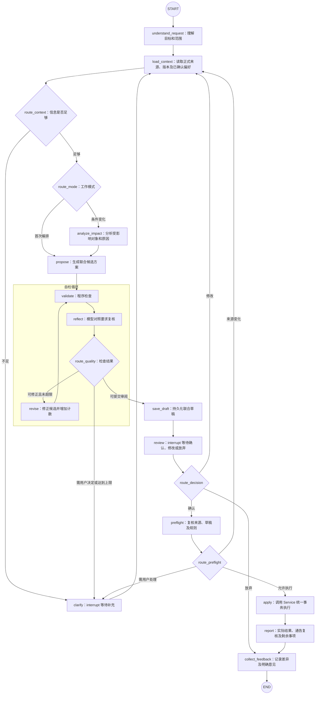
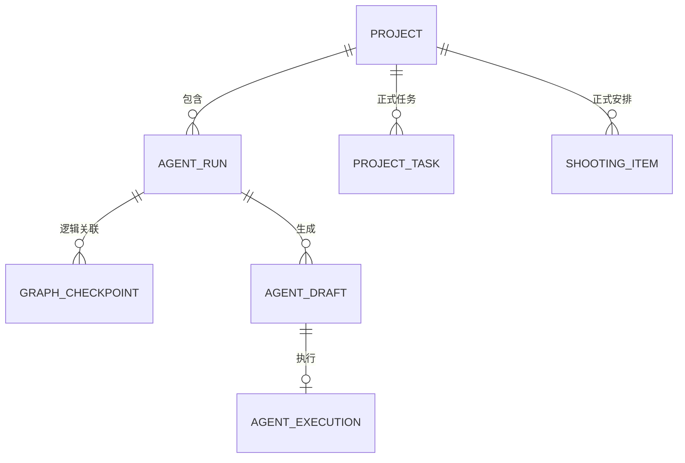
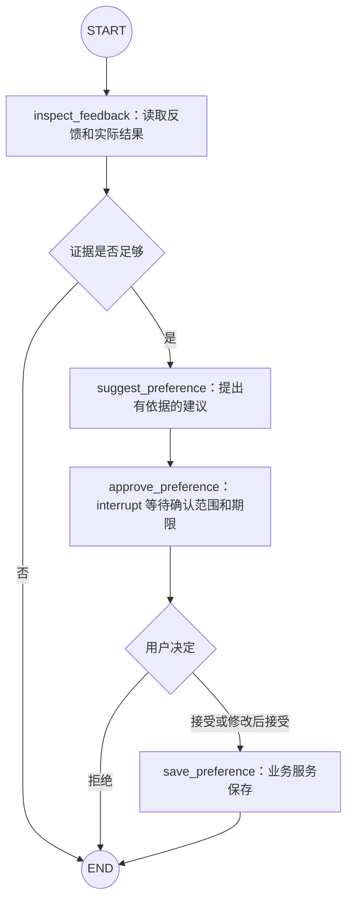

# V5 Agent 整体设计方案

日期：2026-11-04  
状态：讨论整理稿，供审阅；不是已实现说明，也不构成安装依赖、数据库迁移或业务代码修改授权。

## 1. 设计目标

V5 在现有 V1—V4 能力上形成变更闭环：制片提出要求，Agent 读取正式资料、提出项目任务及拍摄安排的联合方案，经程序自检、人工审阅和版本复核后统一执行。

使用场景仍是约 20 人学生剧组、制片单人使用、本地运行。不扩展为多人审批平台，不建设通用工作流引擎。

本文汇总本轮讨论，并区分三种状态：

- **已确认**：用户明确选择，或结论池中仍适用的约定。
- **推荐设计**：用于落实目标的技术方案，仍需结合现有代码审查。
- **待确认**：本轮未确定，不能由实现自行扩大范围。

## 2. 已确认范围

### 2.1 修改对象

Agent 可以同时调整：

1. 整个项目的日程任务，包括筹备、拍摄期间跟进和收尾。
2. 拍摄大计划，包括场次拍摄、转场、用餐、妆造、布光、置景等安排。

相关修改组织成同一份联合草稿，确认后统一执行。不能只把 V5 理解为拍摄排期助手，也不能把所有项目任务塞进拍摄大计划。

项目日程任务表达“做什么、何时完成、谁实施、依赖什么、落实结果是什么”；拍摄大计划表达“具体哪一天、哪个时段安排什么”。两者保留现有数据归属。

### 2.2 两条工作流

| 模式 | 起点 | 输出 |
|---|---|---|
| 协助编排 | 项目节点、当前准备程度、已确认剧本、人员资源档期及制片要求 | 指定范围内的项目任务和拍摄安排草稿 |
| 条件变化后重排 | 已确认变化或明确标注的假设，以及现有计划 | 影响说明、联合调整草稿、缺口及待确认问题 |

两种模式使用一个 Agent、一张主图，共用上下文读取、候选检查、草稿、人工确认和正式执行能力。

### 2.3 执行原则

- 制片主动发起，资料变化本身不自动启动 Agent。
- 已有人工安排默认保留；必须修改时，草稿明确展示原值、新值和理由。
- 候选方案在内存中试算，不先改正式数据再检查。
- 模型估时是待确认建议，不替代制片填写的估时。
- 不虚构档期、资源落实、人员、替代场地或未录入关系。
- 正式执行必须经制片确认，模型没有自行确认、发布通告或对外发消息的工具。
- 拍摄日志和已发布通告不随计划调整被覆盖；通告按相关来源判断是否需要复核。
- 不承诺数学最优；重排优先尝试少改动，但需要清楚解释取舍。

### 2.4 尚未确定的写入权限

当前明确的正式修改对象是项目任务和拍摄安排。以下权限尚未确认：

- 是否允许联合草稿修改开拍、杀青、收尾等项目节点。
- 是否允许修改人员档期、资源落实资料。
- 是否允许修改其他业务事实。

推荐首版把这些资料作为只读依据；用户提出变化时，明确它是已保存事实、本次已确认约束，还是假设。不得把尚未保存的变化冒充数据库事实。

## 3. 总体架构

采用模块化单体，保留 FastAPI、SQLAlchemy、现有模型客户端及前端。LangGraph 管理流程，不替代业务服务。

| 部分 | 责任 |
|---|---|
| Agent / 模型 | 理解要求、选择受控查询工具、分析影响、组织和修正候选方案、说明取舍 |
| LangGraph | 节点连接、条件分支、自检循环、人工中断、状态恢复 |
| Service | 项目隔离、业务规则、草稿生命周期、版本复核、幂等及事务 |
| 纯规则工具 | 候选视图构造、依赖检查、占用检查、缺口计算，不写库 |
| DAO | 数据库读写，不自行提交事务 |
| Checkpointer | 保存和加载 Graph 运行检查点 |

主流程采用明确节点和受控路由。节点内如需工具调用，必须限制工具集合、轮数、查询范围和输出大小，不能再嵌入无界自主循环。

## 4. 主流程图

图中的方框是节点，菱形表示条件边的路由判断。所有节点共享 `V5State`；节点返回字段更新，不把完整状态作为自然语言传递。



错误处理不是“任何异常都回到模型重试”。模型调用失败、存储失败或程序错误应保留最近可恢复进度、返回明确状态；只有可恢复且满足重试条件的操作才重试。

## 5. Graph 状态设计

### 5.1 TypedDict 的作用

推荐用 `TypedDict` 声明内部运行状态结构。它在运行时仍然是普通字典，帮助类型检查和维护，不负责运行时验证，也不负责保存数据库。

接口输入、模型输出、候选修改和恢复命令使用 Pydantic 校验。检查点负责将运行状态持久化。

```text
数据库检查点 → 加载 V5State → 节点执行并更新字段 → 保存新检查点
```

### 5.2 状态字段

| 字段组 | 建议字段 | 内容 |
|---|---|---|
| 身份 | project_id、run_id、state_schema_version | 项目、本次工作编号、状态结构版本 |
| 要求 | request、mode、scope | 原始要求、模式、对象及日期范围 |
| 约束 | constraints、assumptions、questions | 已确认条件、假设、待确认问题及来源 |
| 上下文 | context、source_versions | 本次必需资料、读取来源版本 |
| 影响 | affected_objects、impact_reasons | 受影响对象及依据 |
| 候选 | candidate | 项目任务和拍摄安排的增改取消 |
| 自检 | validation、review_findings、attempt_count | 程序结果、模型复核、修正次数 |
| 草稿 | draft_id、draft_revision | 业务草稿身份和版本 |
| 审阅 | decision、feedback | 本次人工决定及意见 |
| 执行 | preflight_result、execution_id、execution_result | 执行前结果、幂等编号、实际结果 |

状态只保存本次工作需要的信息。全量剧本、所有历史事件和整套项目事实不重复灌入状态；保留必要引用、证据摘要及版本，按需查询。

### 5.3 状态更新规则

- 大部分字段采用覆盖更新；新候选替换旧候选，不自动合并两版修改。
- 只有确需累积的消息或记录使用追加 reducer，并限制规模。
- 候选变化后清除旧检查结果和旧确认；重新检查。
- 来源变化后使旧预检和确认失效，重新加载相关上下文。
- 草稿确认绑定 `draft_id + draft_revision`，不能只确认一个工作编号。
- 单次要求不自动提升为项目长期规则。
- 图恢复需要支持状态结构兼容；升级前定义旧任务可恢复、迁移或明确终止的策略。

## 6. 节点职责

| 节点 | 主要输入 | 输出 | 模型调用 |
|---|---|---|---|
| understand_request | 用户要求、入口模式 | mode、scope、约束和问题 | 是 |
| load_context | 范围、约束 | 正式资料、偏好、来源版本 | 否 |
| clarify | 明确的问题和可选项 | 经校验的用户补充 | 可组织措辞 |
| analyze_impact | 变化、正式关联 | 受影响对象、路径及原因 | 可用模型解释，关系来自程序查询 |
| propose | 正式资料、约束、影响 | 经 Schema 校验的候选修改 | 是 |
| validate | 正式基线、候选修改 | 冲突、缺口、遗漏及依据 | 否 |
| reflect | 用户要求、候选、自检结果 | 要求符合度、遗漏和范围问题 | 是 |
| revise | 候选、检查问题 | 新候选、修正计数 | 是 |
| save_draft | 候选、来源和检查结果 | 持久化草稿身份 | 否 |
| review | 草稿、差异及检查报告 | 确认、修改或放弃 | 否 |
| preflight | 已确认草稿版本 | 最新来源及规则检查结果 | 否 |
| apply | 已确认草稿、执行编号 | 事务提交结果 | 否 |
| report | 实际执行结果 | 用户可读说明和剩余事项 | 可选 |
| collect_feedback | 建议稿、最终稿、明确意见 | 可追溯反馈记录 | 不要求 |

节点不直接执行 SQL 或提交正式业务事务。`preflight` 用于展示和路由，不能替代 `apply` 事务内的再次校验，否则仍存在检查后数据被改动的窗口。

## 7. 边和路由

| 连接 | LangGraph 实现 | 规则 |
|---|---|---|
| 固定步骤 | add_edge | 如 propose → validate |
| 条件分支 | add_conditional_edges | 程序依据状态选择允许的目标 |
| 人工暂停 | interrupt | 返回可序列化的问题或审阅信息 |
| 人工恢复 | Command(resume=...) | 使用原 thread_id，校验恢复输入 |
| 检查点 | compile(checkpointer=...) | 保存和恢复执行状态 |

路由函数不调用模型、不写库。模型可以输出结构化的澄清需求，但不能自由指定任意节点名称或绕过确认进入执行。

除候选修正次数外，还要设置模型调用预算和 Graph 总步数保护。具体限额待评估后确定，不把框架递归上限当作唯一业务限制。

## 8. 自检设计

### 8.1 四层检查

| 层次 | 检查内容 | 负责方 |
|---|---|---|
| 数据合法性 | 项目隔离、引用存在、允许字段、版本、输入结构 | 程序 |
| 业务规则 | 任务依赖、人员资源重叠、可用时间、固定安排、准备缺口 | 程序 |
| 完整性 | 范围内未排场次、未处理任务、缺失估时或档期 | 程序为主，模型辅助发现 |
| 要求符合度 | 是否满足要求、扩大范围、改动无关内容、说明取舍 | 模型复核，程序核对范围 |

程序检查需要同时覆盖正式数据和候选修改后的整体视图，不能只检查被修改对象之间的关系。

### 8.2 检查结果

每个问题至少包含：稳定问题代码、级别、关联对象、具体原因、证据或来源、可行处理方式。未知信息必须标记未知，不能显示为检查通过。

建议区分：

- **禁止执行**：越权引用、无效数据、版本冲突、非法依赖等，不能人工忽略。
- **需要处理的冲突**：档期和固定约束冲突等，修正或由用户明确改变约束后再检查。
- **可提示的缺口**：准备尚未完成、信息待补等，允许先计划时保留提示，不宣称已经可拍。

具体问题代码、级别以及哪些可在知情确认后保留，实施前形成规则清单。模型不得自行降低程序检查级别。

### 8.3 有限修正

有明确可修正问题时进入 revise；修改后重新运行程序检查和模型复核。遇到无法推断的条件、连续无进展或达到上限时暂停询问。

模型自评不能证明正确；降低错误依靠程序规则、人工确认、实际反馈和固定评估共同完成。

## 9. 联合草稿契约

候选和草稿采用经过验证的结构化修改，不接受任意 SQL、任意字段路径或代码。

每项操作包括：

- operation_id：草稿内稳定编号。
- entity：project_task 或 shooting_item。
- action：create、update 或 cancel；优先取消保留历史，物理删除权限另行确认。
- target_id 或 temporary_id：正式对象引用或新增对象临时编号。
- before：供审阅展示的修改前值。
- patch：允许字段范围内的新值。
- reason：修改依据。

示例字段为概念契约，正式命名须对齐现有接口：

```json
{
  "schema_version": 1,
  "operations": [
    {
      "operation_id": "op-1",
      "entity": "project_task",
      "action": "update",
      "target_id": 12,
      "before": {"due_date": "2026-11-10"},
      "patch": {"due_date": "2026-11-12"},
      "reason": "根据已确认的拍摄调整修改服装确认期限"
    }
  ]
}
```

`before` 不作为正式校验依据；执行必须读取数据库。新增对象相互引用时，用临时编号表达，校验引用和依赖，在统一事务内映射正式 ID。

人工编辑草稿后递增 revision，使旧确认和旧检查失效，重新检查。模型迟到结果不得覆盖人工修改；采用草稿版本比较和人工字段保护，具体复用方式核对现有草稿机制后决定。

## 10. 数据库设计

以下是逻辑模型，不直接等于新增四套物理表。实施前检查现有 changes、events、草稿及对话存储能否复用，避免重复建设。

### 10.1 agent_runs：工作记录

| 字段 | 用途 |
|---|---|
| id | 本次工作编号，作为 thread_id 的身份来源 |
| project_id | 项目隔离 |
| mode、request | 模式及原始要求 |
| status | running、waiting_input、waiting_review、completed、abandoned、failed |
| current_draft_id | 当前草稿 |
| created_at、updated_at | 时间 |

它负责列表和业务入口，不重复保存完整状态。状态可能在进程退出时滞后，查询时需要结合检查点和业务执行记录核实；“running”本身不能证明进程仍在运行。

### 10.2 LangGraph 检查点

使用选定持久化包提供的表结构，由包管理，不自行设计替代内部表。通过 thread_id 与工作记录逻辑关联，不强行修改第三方表增加外键。

推荐本地首版使用持久化 SQLite checkpointer，可与业务库使用不同文件；依赖包、版本、同步或异步使用方式以及连接生命周期待核对兼容性后确定。开发用内存 saver 不满足重启恢复验收。

### 10.3 agent_drafts：联合草稿

| 字段 | 用途 |
|---|---|
| id、run_id、project_id | 身份和归属 |
| revision、schema_version | 草稿编辑版本、结构版本 |
| status | pending、executed、abandoned、invalidated |
| source_versions_json | 来源版本 |
| changes_json | 联合修改内容 |
| validation_json | 检查报告及所对应的候选版本 |
| rationale_json | 理由、假设和缺口 |
| created_at、updated_at | 时间 |

首版推荐将有限规模的修改项保存为校验后的 JSON，不先拆修改项明细表。需要保留建议稿到最终稿的差异，可通过不可变草稿快照或现有事件记录实现；仅覆盖一列 JSON 不足以支撑反馈追溯，选用哪种复用方案待代码审查确定。

### 10.4 agent_executions：执行凭据

| 字段 | 用途 |
|---|---|
| id | 唯一执行编号 |
| project_id | 所属项目 |
| draft_id、draft_revision | 已确认的草稿版本 |
| result_json | 正式对象 ID、临时 ID 映射和事件编号 |
| executed_at | 提交时间 |

对 `(draft_id, draft_revision)` 设置唯一约束；同时保证同一草稿生命周期不能重复执行不同版本。成功凭据与业务修改在同一事务提交，失败尝试另外记录诊断，不写成成功凭据。



### 10.5 事务边界

检查点和业务提交不构成一个分布式事务，也不需要引入分布式事务系统。

若业务提交成功、检查点更新前进程退出，恢复后 apply 必须通过执行编号和草稿执行状态查到原结果，返回已有结果，不再新增任务或安排。

## 11. 暂停和恢复

- 一次独立编排工作对应一个 thread_id；同项目的不同工作不共用一个状态。
- 恢复接口按 project_id 和 run_id 检查归属，不能仅凭客户端传入 thread_id 直接恢复。
- clarify 和 review 使用 interrupt，传递 JSON 可序列化内容。
- 同一个工作同时只允许一个有效执行者；重复恢复、双击确认和多个页面提交要有服务端排他或版本竞争保护。
- 恢复会重新进入节点执行，不是冻结任意 Python 代码行；interrupt 之前避免不可幂等副作用。
- 模型调用期间不持有业务数据库事务，不长期持锁等待人工输入。
- 恢复后重新核实相关正式来源；来源变化后不能沿用旧确认。
- 节点和 Schema 变更应考虑未结束任务的兼容策略。

## 12. 正式执行

`confirm_draft` 是业务服务能力，不能作为模型自由调用工具。

```text
开始短事务
  → 检查项目、草稿状态、确认版本
  → 检查是否已经执行；若已执行，返回原结果
  → 校验来源版本及最新业务规则
  → 应用任务修改
  → 应用拍摄安排修改
  → 保存业务事件、执行凭据、草稿执行状态
提交事务
```

任一步失败整体回滚。并发情况下还需通过现有项目版本更新、数据库约束及适当的条件更新防止两个请求同时越过检查；不能只依赖前端按钮禁用。

现有任务和拍摄服务若各自 commit，应提取可在同一 Session 内复用的业务操作，由外层 Service 统一提交。不能串联两个独立保存接口来模拟原子执行。

确认后的执行结果以数据库记录为准。结果说明生成失败不能将已成功提交报告为未执行，重试报告也不能重放业务修改。

## 13. 代码架构

根据项目 AGENTS.md，Agent 专用接口、状态、Schema、提示词和流程集中在 backend/agent。正式业务规则和存储仍沿用现有技术分层。

```text
backend/
├─ agent/
│  ├─ router.py             发起、恢复、查询接口
│  ├─ runner.py             Graph 调用和进度事件
│  ├─ graph.py              节点注册、边和路由
│  ├─ state.py              V5State
│  ├─ schemas.py            Agent 输入、候选、审阅和恢复契约
│  ├─ nodes.py              首版节点实现，按需再拆分
│  ├─ context.py            有范围限制的上下文组装
│  ├─ tools.py              受控查询及检查工具适配
│  ├─ prompts.py            专用提示词
│  └─ checkpoint.py         检查点初始化和连接管理
├─ service/
│  ├─ agent_workflow.py     工作记录、联合草稿、幂等执行
│  └─ ...                   现有任务和拍摄业务逻辑
├─ tools/
│  └─ planning_checks.py    候选合并和纯规则检查
├─ dao/
│  └─ agent.py              所需业务记录存取
└─ models/
   └─ agent.py              确认需要新增的 ORM 模型
```

文件名是职责建议，实施前对齐现有文件，不建立无用空文件。之前讨论中将专用 Schema 放到 backend/schemas 的示例，以本节集中在 agent 的方案为准。

依赖方向：router → runner → graph/nodes → 业务服务或纯工具 → DAO。Service 不导入 LangGraph 或 FastAPI，节点不直接访问 SQL，不复制现有业务校验。

建议先明确以下接口，最终参数和类型以代码审查为准：

```text
load_context(project_id, scope)
validate_candidate(context, candidate)
save_draft(project_id, run_id, candidate, source_versions, validation)
confirm_draft(project_id, draft_id, draft_revision, execution_id)
```

## 14. 页面交互

入口支持统一助手和具体业务记录。具体入口可预填范围，意图不清时先询问。

页面需要呈现：

1. 当前阶段和真实状态：读取、生成、检查、待补充、待审阅、执行完成或失败，不伪造百分比。
2. 联合草稿：任务和拍摄安排分组，展示新增、修改、取消及差异。
3. 依据：来源、假设、固定约束、冲突和准备缺口。
4. 操作：修改草稿、要求重做、确认或放弃，失败保留输入。
5. 执行结果：实际修改、需复核通告、未解决事项和可追溯记录。

首版不以增加大量页面为目标，优先复用现有助手、任务和拍摄界面。进度传输方式在核对现有流式能力后确定。

## 15. 越用越好用

### 15.1 反馈来源

- 制片接受、修改或拒绝了哪些建议。
- 建议稿和最终稿的差异。
- 用户明确填写的原因。
- 后续任务结果和拍摄日志中的估时偏差、遗漏、冲突及返工。

接受不代表质量一定好，差异也不能自动证明用户偏好。例如移到下午可能只是一次档期限制。

### 15.2 经验分级

| 类别 | 用法 |
|---|---|
| 本次约束 | 仅用于当前工作 |
| 项目规则 | 经确认后，按项目和有效时间读取 |
| 跨项目偏好 | 是否建设尚未确认，不默认收集或应用 |

已确认偏好应可查看、修改、停用和删除。业务规则和本次明确要求优先，偏好不能覆盖硬约束。

### 15.3 独立复盘流程

推荐按需触发，不在每次安排结束后强行自动运行，也不默认另加审查 Agent。



偏好持久化到业务存储，不依靠某次检查点永久记忆。偏好具体表结构待范围确认后设计，首版不提前引入通用记忆平台、RAG 或向量库。

### 15.4 固定评估

把真实失败脱敏整理成回归案例。修改模型、提示词、工具或图后，对比硬冲突漏检、目标遗漏、无关改动、人工修改量和完成率。不能只看模型自评分数或用户确认率。

“越用越好用”通过反馈、确认后的偏好和开发改进形成，不是运行时自行修改代码、提示词或训练模型。

## 16. 验证方案

### 16.1 规则检查

- 任务依赖、取消任务、无日期任务、跨午夜和并行安排。
- 修改项与未修改正式数据之间的冲突。
- 人员资源未知、明确不可用、稳定 ID 关联和准备缺口。
- 同一草稿新增对象之间的临时 ID 和依赖。

### 16.2 流程测试

- 两种模式均可生成联合草稿。
- 信息不足暂停，补充后重新读取资料。
- 自检可修正、达到上限、无进展和必须询问的分支。
- 放弃不修改正式数据；人工草稿修改不被模型迟到结果覆盖。
- 来源变化导致旧确认失效并重新审阅。

### 16.3 持久化和事务

- 后端重启后恢复待补充和待审阅工作。
- 重复恢复、重复确认、并发确认只产生一次有效执行。
- 任一业务修改失败，任务和拍摄安排全部回滚。
- 业务提交成功但检查点未更新时，恢复返回原结果。
- 旧草稿 revision、跨项目引用、非法字段和错误恢复输入被拒绝。
- 报告生成失败不重复执行已提交业务。

### 16.4 真实验收

用代表性剧本和真实制片条件核对方案可用程度、遗漏、解释成本及人工修改量。自动检查通过不替代真实剧组使用验收。

代码实施后按实际改动运行后端测试、离线评估、前端逻辑测试、构建及关键浏览器流程，记录真实结果。本文件编写不代表已运行这些验证。

## 17. 建议实施顺序

1. **核对现有业务能力**：读取、版本、草稿、事务边界和旧 Agent 工具，列出复用及改造点。
2. **闭合联合草稿**：先完成候选契约、纯规则检查、人工审阅和统一确认事务；可不依赖模型验证业务闭环。
3. **接入 LangGraph**：实现两种模式、有限自检循环、人工中断和持久化恢复，接入现有模型客户端。
4. **验证故障路径**：重点覆盖幂等、并发、来源变化、恢复和人工输入保护。
5. **积累反馈**：保留差异和明确原因，完善固定评估；偏好范围确认后再建设复盘和保存能力。

各阶段交付可使用、可验证的结果；不因目录整齐重写现有系统，不承诺尚无依据的工期。

## 18. 实施前待确认

| 事项 | 当前建议或状态 |
|---|---|
| 项目节点修改 | 尚未授权纳入联合写入，推荐首版只读 |
| 人员资源资料修改 | 首版只读；变化是事实、约束还是假设必须区分 |
| 偏好范围 | 项目内或跨项目尚未确定 |
| 检查问题分级 | 需明确硬限制、可变约束和可保留缺口 |
| 候选修正预算 | 修正次数、工具轮数及模型预算待评估 |
| LangGraph 依赖 | 版本、检查点包、同步或异步方式待核对 |
| 数据库迁移 | 先核对已有草稿和事件复用，再确认物理表和迁移 |
| 旧 Agent 兼容 | 明确保留哪些查询、停用哪些旧写入，避免新旧业务混用 |
| 状态升级 | 未结束任务的兼容及恢复策略待明确 |

以上事项不妨碍审阅整体方案，但在对应实施前必须明确，不能默认为已授权。

## 19. 参考资料

- [项目结论池](../结论池.md)：已有能力、业务边界和 V5 原始目标。
- [LangGraph 人工中断](https://docs.langchain.com/oss/python/langgraph/interrupts)：interrupt、Command 恢复、thread_id 及节点重执行注意事项。
- [LangGraph 持久化](https://docs.langchain.com/oss/python/langgraph/persistence)：checkpointer 的职责和状态持久化机制。

官方文档用于核对框架能力；本文目录、业务契约、表结构和实施顺序是针对本项目提出的设计，不是框架强制要求。
